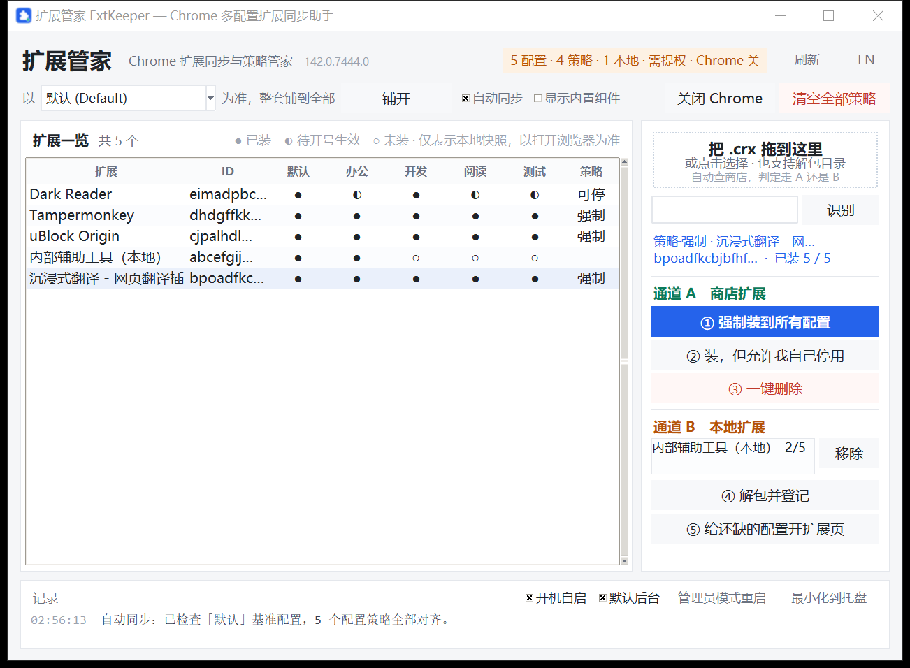

# ExtKeeper · Chrome 多配置扩展同步管家 (Windows Chrome Multi-Profile Extension Sync & Policy Manager)

<p align="center">
  <b>简体中文</b> | <a href="README_EN.md">English</a>
</p>

<p align="center">
  <b>无需管理员权限 · HKCU 组策略跨配置文件自动同步 Chrome 扩展 · 本地 CRX 解包辅助 · 开机自启 &amp; 默认后台系统托盘</b><br/>
  <sub>Sync &amp; batch-manage Chrome extensions across all local profiles on Windows via HKCU Group Policy — with zero-dependency native tray, auto-start &amp; background auto-sync.</sub>
</p>



---

## 为什么需要它？

在一台 Windows 电脑上同时使用多个 Chrome 配置文件（工作账号、个人账号、开发测试环境等）时，Chrome 原生同步是**按 Google 账号隔离**的——在配置 A 安装的扩展不会出现在配置 B/C/D 中。

**ExtKeeper（扩展管家）** 利用 Windows 当前用户层组策略（`HKCU\Software\Policies\Google\Chrome`）突破账号隔离，在不修改 `Secure Preferences`、不需要管理员权限的前提下，把商店扩展统一同步到本机所有 Chrome 配置文件；并针对非商店本地 `.crx` 扩展提供解包、放行安装源与定向打开缺失配置扩展页的半自动流水线。

---

## 核心特性

- **双通道统一管理（Dual-Channel Management）**
  - **通道 A｜Chrome 商店扩展**：拖入 `.crx`、点击选文件、粘贴商店链接 / 32 位 ID，或单击左侧表格行，一键写入 `ExtensionInstallForcelist`（全配置强制同步）或 `ExtensionSettings`（自动安装且允许手动停用），并支持一键撤除策略自动卸载。
  - **通道 B｜本地 / 私有扩展**：自动解析 CRX2 / CRX3 头部 ID，解包到 `packs\<ID>\` 并留存原包，自动写入 `ExtensionInstallSources` 放行 `file:///*`，一键仅给「还缺少该扩展」的配置文件批量打开 `chrome://extensions` 窗口。
- **整套铺开 & 定时自动同步（One-Click Spread & Auto-Sync）**
  - 选定任意基准配置（如 `Default`），一键将其全部商店扩展铺开到本机所有配置；
  - 支持开启 **「自动同步」**，每分钟轻量巡检基准配置新增的商店扩展并增量补齐策略（只增不删，不破坏已有手动设置）。
- **开机自启 & 默认后台系统托盘（Auto-Start & Background Tray）**
  - **开机自启**：写入 `HKCU\Software\Microsoft\Windows\CurrentVersion\Run\ExtKeeper`，通过 `pythonw.exe` 静默拉起，无黑框、免 UAC 提权。
  - **默认后台**：启动直接进入右下角系统托盘，点击关闭按钮（`×`）自动隐藏到托盘不退出；基于纯 Win32 API（`ctypes`）实现，零第三方托盘库依赖。
  - **单实例保护**：后台驻留时再次打开程序，自动唤醒已有主窗口至前台。
- **单文件便携 · 零硬依赖**
  - 核心主程序仅 [extkeeper.pyw](extkeeper.pyw) 一个文件，仅依赖 Python 标准库即可运行；`tkinterdnd2` 与 `pillow` 为纯可选增强依赖。

---

## 快速开始

### 环境要求

- Windows 10 / 11
- Python 3.8+（安装时需包含 `tkinter`）

### 安装可选依赖（推荐）

不安装也可完整使用（拖放区会自动降级为点击选择文件）；安装后可启用**窗口直接拖拽**与**自动绘制高分辨率图标**：

```bash
pip install -r requirements.txt
```

### 启动方式

1. 双击 **`启动.bat`**（自动定位 `pythonw.exe` / `pyw.exe` 无黑框运行）。
2. 或通过命令行启动：

```bash
pythonw extkeeper.pyw
```

支持的命令行参数（`启动.bat` 同样支持透传）：

| 参数 | 说明 |
| --- | --- |
| `--background` / `--minimized` | 强制以后台系统托盘方式静默启动 |
| `--show` | 强制前台显示主界面（忽略默认后台偏好） |
| `--autostart` | 开机自启标识（按已保存的「默认后台」设置决定是否静默） |

---

## 技术原理与 Chrome 版本限制说明

在 Chrome 137 ~ 158 实测确认以下平台限制：

1. `--load-extension` 启动参数在 Chrome 137 被移除，Chrome 142 连 `DisableLoadExtensionCommandLineSwitch` 回旋开关一并移除；
2. Chrome 官方策略规定：**非域控 Windows 机器（未加入 AD / Azure AD / Chrome Enterprise Core）禁止通过组策略强制安装 Chrome Web Store 以外的扩展**；
3. 直接篡改 `Secure Preferences` 的 HMAC 校验在 Chrome 升级时极易导致整个扩展列表判废，因此本工具绝不触碰该文件。

因此采用 **「商店扩展走 HKCU 组策略全自动同步（通道 A）+ 本地扩展解包放源并定向开页半自动安装（通道 B）」** 是非域个人 Windows 环境下最稳妥可靠的架构。

### 使用提示

- 修改策略后，需**完全退出 Chrome（包含托盘后台进程）再重新打开**才会生效。
- 强装模式（`force_installed`）下扩展页会提示「由贵单位管理」且无法单独停用；如需自动安装且允许随时自行开关，请点击 **「② 装，但允许我自己停用」**。
- 「③ 一键删除」仅撤除由策略安装的扩展；此前手动装过的本地记录可能留在原地。

---

## 仓库结构

```text
.
├── extkeeper.pyw       # 主程序（双通道策略同步、开机自启、原生 Win32 系统托盘）
├── 启动.bat            # Windows 双击静默启动脚本（支持透传命令行参数）
├── extkeeper.ico       # 应用窗口与系统托盘图标
├── requirements.txt    # 可选增强依赖（tkinterdnd2、pillow）
├── README.md           # 简体中文说明文档
├── README_EN.md        # English Documentation
├── 读我.txt            # 简明纯文本本地使用指南
├── LICENSE             # MIT License
└── docs/
    └── screenshot.png  # 界面预览图（脱敏演示数据）
```

---

## 开源协议

本项目基于 [MIT License](LICENSE) 开源。
