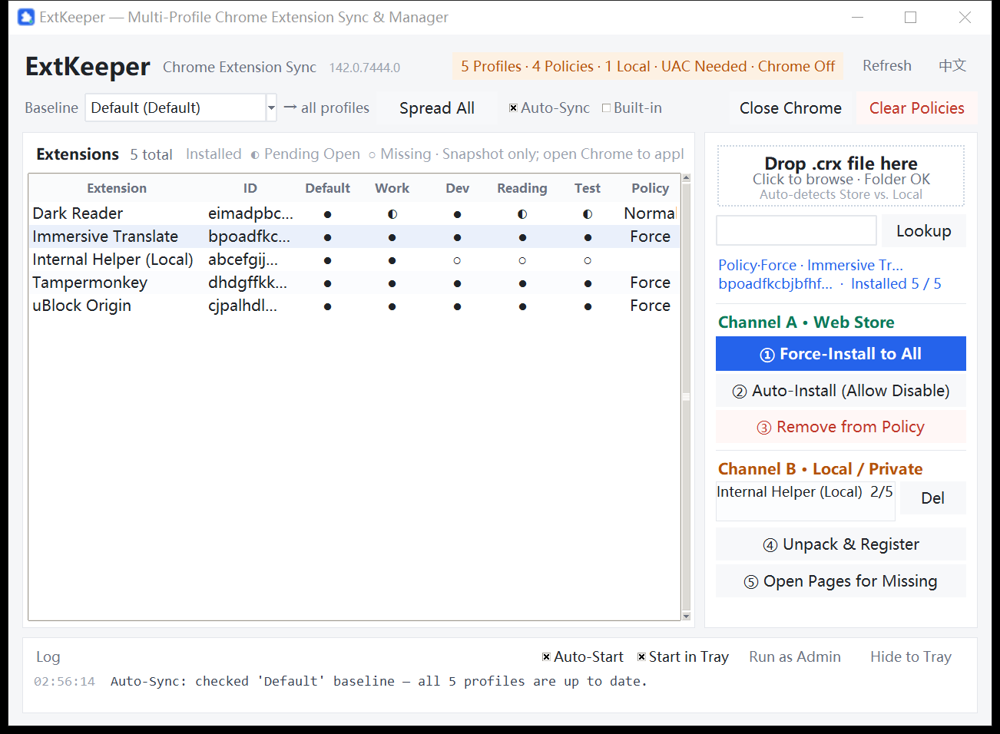

# ExtKeeper — Multi-Profile Chrome Extension Sync & Policy Manager for Windows

<p align="center">
  <a href="README.md">简体中文</a> | <b>English</b>
</p>

<p align="center">
  <b>Portable single-file Windows EXE (no Python required) · Sync &amp; batch-manage Chrome extensions across all local profiles via HKCU Group Policy · Instant Bilingual UI (EN/中文) · Native System Tray, Auto-Start &amp; Background Auto-Sync.</b>
</p>

<p align="center">
  <a href="https://github.com/wsadan7-prog/ExtKeeper-Chrome-Extension-Sync/releases/latest"><b>⬇ Download Portable ExtKeeper.exe (Latest Release)</b></a>
</p>



---

## Why ExtKeeper?

When running multiple Chrome profiles on the same Windows machine (work, personal, dev, testing), Chrome's built-in sync is strictly **isolated per Google account** — installing an extension in Profile A never propagates it to Profiles B, C, or D.

**ExtKeeper** solves this cleanly using Windows Group Policy (`HKCU\Software\Policies\Google\Chrome`):
- **Standard-user GUI with on-demand UAC elevation**: Keeps the main window non-elevated so `.crx` drag-and-drop works seamlessly, and requests UAC elevation only when writing protected Windows policy keys or cleaning conflicting `HKLM` policies.
- **Never tampers with `Secure Preferences`** or Chrome's HMAC signatures (zero risk of corrupting your profile).
- Covers both **Chrome Web Store extensions** (fully automated sync & global uninstall) and **unpacked / private `.crx` extensions** (streamlined semi-automated installation).

---

## Key Features

- **Dual-Channel Extension Management**
  - **Channel A — Chrome Web Store Extensions**: Drop a `.crx`, browse a file, paste a Web Store URL / 32-char ID, or click any row in the matrix to apply `ExtensionInstallForcelist` (force-install across all profiles) or `ExtensionSettings` (`normal_installed`, auto-installed yet user-toggleable); **Remove** supports both revoking policy and writing Chrome's `removed` policy to uninstall manually installed copies across all profiles.
  - **Channel B — Local / Private Extensions**: Parses CRX2/CRX3 protobuf headers to extract extension IDs, unpacks to `packs\<ID>\`, enables `ExtensionInstallSources` (`file:///*`), and opens `chrome://extensions` **only for profiles still missing that extension**.
- **Google Account Names & Three-State Matrix**
  - Prioritizes Google account names (`gaia_name`) and follows Chrome's native `profiles_order`, while filtering out empty uninstalled remnants in `Secure Preferences`.
  - Clearly distinguishes **`● Installed`**, **`◐ Pending Open`** (policy written, open profile to download), **`✕ Pending Remove`**, and **`○ Missing`**.
- **On-Demand UAC, Conflict Cleanup & One-Click Close Chrome**
  - Automatically prompts UAC when Windows restricts writes to `HKCU\Software\Policies\Google\Chrome`, and detects/cleans legacy conflicting `HKLM` extension policies without touching unrelated policies (WebRTC, DNS, etc.).
  - Built-in **Close Chrome** button (toolbar & tray menu): attempts a graceful close first to preserve tabs, then force-terminates remaining background `chrome.exe` processes so new policies load cleanly on next launch.
- **Baseline Spread & Background Auto-Sync**
  - Pick any baseline profile and spread all of its Web Store extensions to every local profile in one click.
  - Enable **Auto-Sync** to scan the baseline profile every 60 seconds and incrementally add newly installed store extensions to policy (additive only — never deletes existing manual policies).
- **Launch at Startup & Start in Background (Zero-Dependency Native Tray)**
  - **Auto-Start**: Registers `HKCU\Software\Microsoft\Windows\CurrentVersion\Run\ExtKeeper` for silent, console-free startup without admin rights (works for both `ExtKeeper.exe` and `.pyw`).
  - **Start in Tray**: Launches directly into the Windows system tray; clicking the close button (`×`) hides to tray instead of exiting. Built directly on Win32 APIs via `ctypes` (no `pystray` or `pywin32` required).
  - **Single-Instance Activation**: Launching ExtKeeper again while it runs in the tray automatically brings the existing window to the foreground.
- **Built-in Bilingual Interface (English / 简体中文)**
  - Automatically follows your Windows UI language on first launch (English on non-Chinese Windows, Simplified Chinese on Chinese Windows).
  - Click **`中文` / `EN`** at the top-right corner (or right-click the tray icon) to switch the entire UI, dialogs, tray menu, and logs instantly without restarting.

---

## Quick Start

### Option 1: Portable EXE (Recommended — No Python Required)

1. Download **`ExtKeeper.exe`** from the [Latest Release](https://github.com/wsadan7-prog/ExtKeeper-Chrome-Extension-Sync/releases/latest).
2. Place it in any permanent folder (e.g., `D:\Tools\ExtKeeper\`) and double-click to run. Settings (`settings.json`), local pool (`local.json`), and unpacked extensions (`packs\`) are stored right next to `ExtKeeper.exe`.

### Option 2: Run from Source (Python 3.8+)

1. Install Python 3.8+ on Windows (with `tkinter` enabled).
2. *(Optional)* Install drag-and-drop & icon helpers (app works without them):
   ```bash
   pip install -r requirements.txt
   ```
3. Double-click **`启动.bat`** or run `pythonw extkeeper.pyw`.

### CLI Flags (Supported by `ExtKeeper.exe` & `启动.bat`)

| Flag | Behavior |
| --- | --- |
| `--background` / `--minimized` | Force silent launch into the Windows system tray |
| `--show` | Force showing the main window on startup |
| `--lang=en` / `--lang=zh` / `--lang=auto` | Override UI language (English / Chinese / Follow System) |
| `--autostart` | Startup launcher flag (respects saved background preference) |

---

## Technical Background & Chrome Limitations

Verified on modern Chrome builds (Chrome 137–158):

1. `--load-extension` was removed in Chrome 137, and its fallback policy `DisableLoadExtensionCommandLineSwitch` was removed in Chrome 142.
2. Per official Chrome Enterprise documentation, **off-store extensions cannot be force-installed via policy on non-domain-joined Windows machines** (outside AD / Azure AD / Chrome Enterprise Core).
3. Modifying `Secure Preferences` directly breaks HMAC validation across Chrome updates and risks wiping the profile's extension list.

Splitting Store extensions (Channel A via HKCU Policy) from Private/Local `.crx` packages (Channel B via `ExtensionInstallSources` + targeted profile windows) is therefore the cleanest, safest architecture on personal Windows machines.

### Good to Know

- **Close all Chrome background processes first**: All Chrome profiles share one browser process. Click **Close Chrome** in ExtKeeper and reopen Chrome (or visit `chrome://policy` and click **Reload policies**) so new policies take effect.
- **Open each profile window to trigger downloads**: Chrome does not download extensions in the background for unopened profiles. Open each target profile window and wait ~5–20 seconds; new icons appear under the **🧩 Extensions** menu. Click **Refresh** in ExtKeeper afterwards to update `◐` to `●`.
- **Force-Install vs. Allow Disable**: Extensions added via **Force-Install** show *"Managed by your organization"* and cannot be disabled individually; use **Auto-Install (Allow Disable)** if you prefer toggleable installs (note: Chrome won't reinstall via `normal_installed` on profiles that previously uninstalled that extension).
- **Remove**: Supports either revoking managed policy or writing Chrome's `removed` policy to uninstall manually installed copies across all profiles (re-installation remains allowed afterwards).

---

## Repository Structure

```text
.
├── extkeeper.pyw         # Main application (dual-channel sync, bilingual UI, auto-start, native tray)
├── 启动.bat              # Windows source launcher (console-free pythonw/pyw lookup + arg forwarding)
├── extkeeper.ico         # Application window & system tray icon
├── requirements.txt      # Optional dependencies for source runs (tkinterdnd2, pillow)
├── README.md             # Chinese documentation
├── README_EN.md          # English documentation
├── 读我.txt              # Plain-text quick reference (Chinese)
├── LICENSE               # MIT License
└── docs/
    ├── screenshot.png    # Anonymized Chinese UI preview
    └── screenshot_en.png # Anonymized English UI preview
```

---

## License

Released under the [MIT License](LICENSE).
